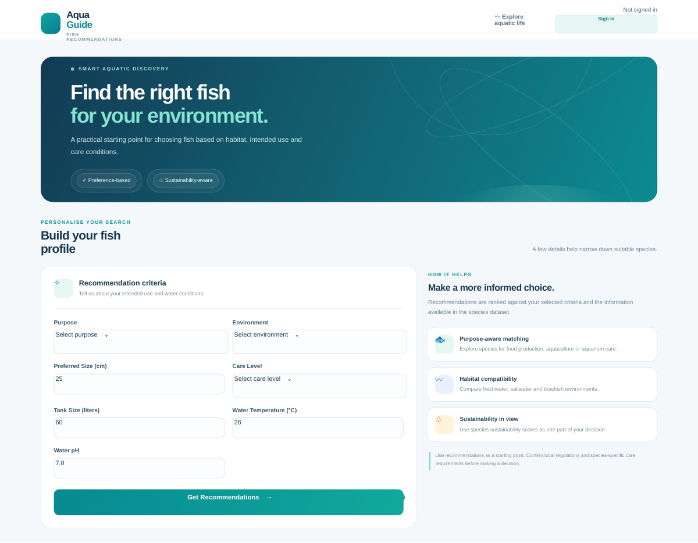

<div align="center">

# AquaGuide
### Fish Recommendations System

**A practical fish selection interface for consumption, aquaculture and aquarium planning.**

Explore species using purpose, habitat and care-related criteria in one simple workflow.


</div>

---

## Overview

AquaGuide is a web application that helps users explore fish species against a set of practical criteria. Users can select a purpose and aquatic environment, then provide preferred fish size, care level, tank capacity, water temperature and pH. The application ranks matching species from its included fish dataset.

The interface also presents sustainability scores and can display market or environmental data through external API requests in the fish recommendation cards.

## Dashboard



## Features

- **Criteria-based recommendations** for consumption, aquaculture and aquarium use.
- **Habitat filtering** across freshwater, saltwater and brackish environments.
- **Care and water-condition inputs** including preferred size, care level, tank capacity, temperature and pH.
- **Ranked species results** based on purpose, environment, size, care conditions and sustainability score.
- **Fish information cards** with scientific name, environment, size and sustainability index.
- **Sustainability guidance** explaining the factors users should consider when choosing species.
- **Sign-in integration** using NextAuth session state, with preference retrieval and saving endpoints for authenticated users.

> The included species list and recommendation scoring are local application data. External API data depends on the availability and response format of the configured services.

## Technology

| Area | Technologies |
| --- | --- |
| Web application | Next.js 14, React 18, TypeScript |
| Styling | Tailwind CSS, CSS |
| UI components | Radix UI primitives, shadcn-style components, Lucide React |
| Authentication integration | NextAuth.js |
| Data layer | Prisma Client and a Prisma schema |
| Recommendation logic | TypeScript scoring over a local fish dataset |

## Run locally

### Requirements

- Node.js 20 or newer recommended
- npm
- A database and authentication configuration if you intend to use the authenticated preference features

### Setup

1. Download or clone this repository.
2. Install dependencies:

   ```bash
   npm install
   ```

3. Configure the environment variables required by your chosen NextAuth provider and Prisma database. Do not commit real credentials or `.env` files.
4. Generate the Prisma client when using the database-backed features:

   ```bash
   npx prisma generate
   ```

5. Start the development server:

   ```bash
   npm run dev
   ```

6. Open [http://localhost:3000](http://localhost:3000).

To create a production build, run:

```bash
npm run build
npm run start
```

## Repository structure

```text
app/
  api/                  API routes
  components/            Recommendation form, fish cards and authentication UI
  lib/                   Fish dataset, scoring logic and external API helpers
  recommendations/       Recommendation results page
  page.tsx               Main dashboard
  layout.tsx             Shared application shell
components/ui/            Reusable interface components
prisma/                   Prisma schema
public/                   Static assets
docs/screenshots/         Project screenshots
```

## Notes

- Recommendations are only as reliable as the supplied species data and scoring rules. Confirm local requirements and species-specific care guidance before acting on a recommendation.
- External market and environmental information may be unavailable or incomplete when upstream services change or are unreachable.
- The supplied source does not include a NextAuth route/provider configuration or a complete Prisma schema. Sign-in and database-backed preference saving therefore need those pieces to be implemented and configured before they can work. The current dashboard and local recommendation logic are separate from that setup.

---

<div align="center">
  <sub>AquaGuide · Fish Recommendations System</sub>
</div>
